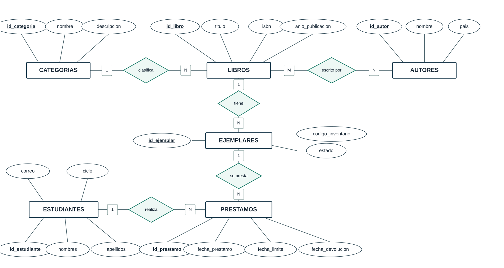
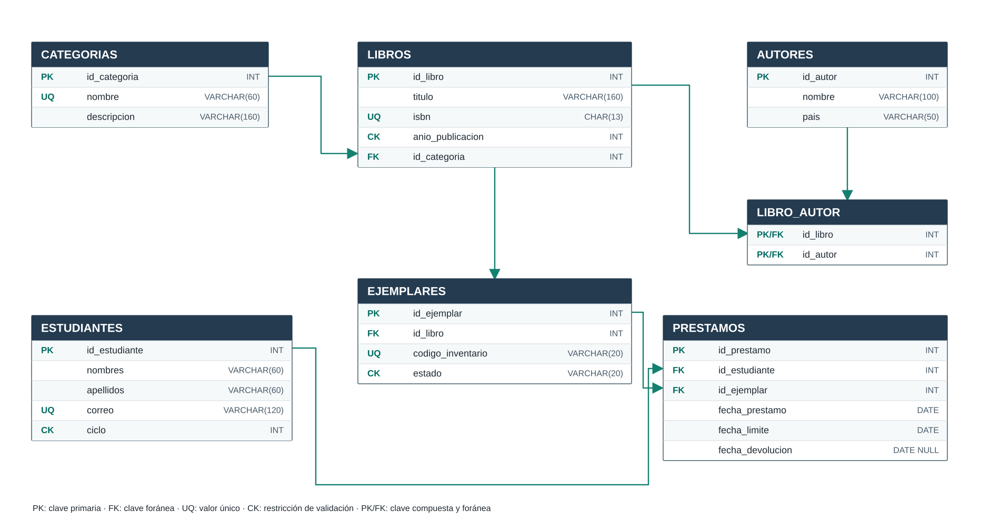

# Portafolio de Base de Datos

**Universidad Nacional de Loja — Carrera de Computación**  
**Base de Datos · Unidad 1 · Ciclo 3A**  
**Estudiante:** Emerson Chamba Galarza  
**Docente:** Edwin René Guamán Quinche

## Proyecto: Biblioteca Universitaria
El objetivo es diseñar una base relacional para controlar los ejemplares y préstamos de una biblioteca. Se distingue el título del libro de su copia física. La autoría múltiple se resuelve con la tabla intermedia LIBRO_AUTOR.

## Modelo Entidad–Relación y relacional
### Modelo Entidad–Relación

### Modelo relacional

[Ver ambos diagramas](diagramas/entidad_relacion.md) · [Descargar el modelo relacional SVG](diagramas/modelo_relacional.svg)

## Implementación SQL
| Tabla | Registros |
|---|---:|
| CATEGORIAS | 7 |
| AUTORES | 9 |
| ESTUDIANTES | 9 |
| LIBROS | 12 |
| LIBRO_AUTOR | 17 |
| EJEMPLARES | 16 |
| PRESTAMOS | 21 |
| **Total** | **91** |

[Creación de tablas](sql/01_creacion_tablas.sql) · [Inserciones de datos](sql/02_inserciones.sql) · [Script completo](sql/biblioteca_mysql_completo.sql)

## Cinco consultas de álgebra relacional
| Consulta | Operadores | Filas |
|---|---|---:|
| Vencidos sin devolver | σ, π, ⋈ | 4 |
| Correos de dos categorías | ∪, σ, π | 6 |
| Libros nunca prestados | − | 2 |
| Préstamos pendientes | ⋈, σ | 11 |
| Préstamos por categoría | γ, COUNT | 6 |

[Operaciones de álgebra](docs/Algebra_relacional.md) · [Consultas SQL](sql/03_consultas.sql)

## Conclusiones
Separar libros y ejemplares evita confundir varias copias del mismo título. Las claves foráneas relacionan los préstamos con estudiantes y ejemplares. Las consultas permiten identificar préstamos pendientes y analizar la circulación por categoría.

[Informe de fin de unidad](docs/Informe_Unidad_1.md)
