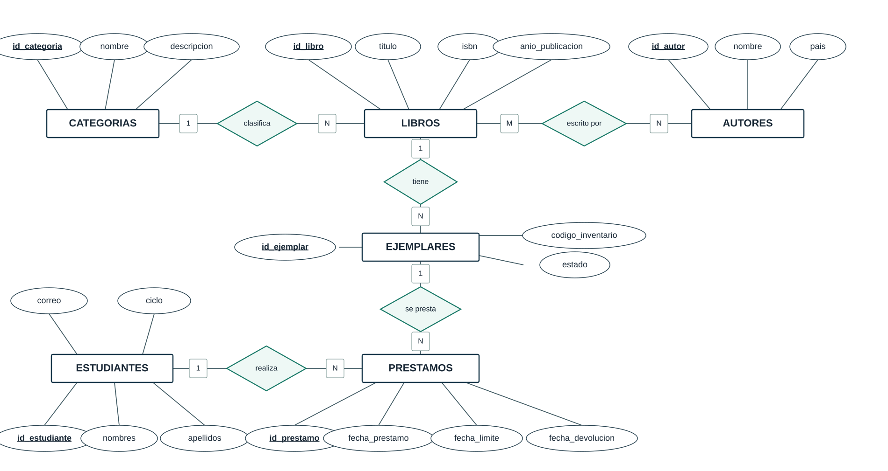
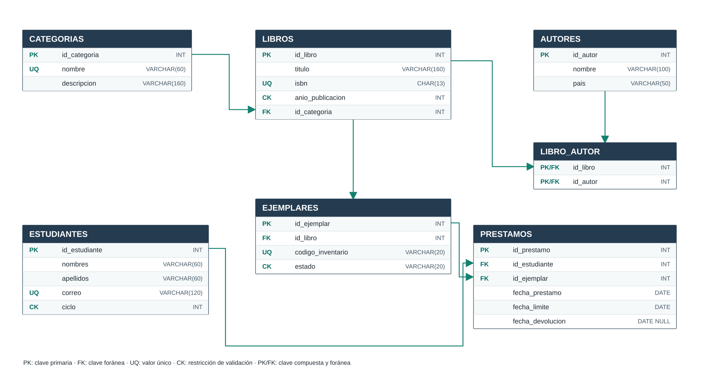

# Biblioteca Universitaria

**Universidad Nacional de Loja — Carrera de Computación**  
**Base de Datos · Unidad 1 · Ciclo 3A**  
**Estudiante:** Emerson Chamba Galarza  
**Docente:** Edwin René Guamán Quinche

## Descripción
Proyecto académico de base de datos relacional para registrar estudiantes, autores, categorías, títulos, ejemplares y préstamos. Los datos son ficticios.

| Tabla | Registros |
|---|---:|
| CATEGORIAS | 7 |
| AUTORES | 9 |
| ESTUDIANTES | 9 |
| LIBROS | 12 |
| LIBRO_AUTOR | 17 |
| EJEMPLARES | 16 |
| PRESTAMOS | 21 |
| **Total** | **91** |

## Contenido
- [Portafolio completo](Portafolio.md)
- [Informe de Unidad 1](docs/Informe_Unidad_1.md)
- [SQL completo MySQL](sql/biblioteca_mysql_completo.sql)
- [DDL](sql/01_creacion_tablas.sql), [DML](sql/02_inserciones.sql), [5 consultas](sql/03_consultas.sql)
- [Siete archivos CSV](datos/csv/)
- [Diagrama Entidad–Relación](diagramas/entidad_relacion.md), [modelo relacional](diagramas/modelo_relacional.md) y [álgebra relacional](docs/Algebra_relacional.md)
- [Guía de uso](docs/Guia_de_uso.md)

## Diagramas del proyecto

**Modelo Entidad–Relación**

**Modelo relacional**

## Instalación
Abre MySQL Workbench y ejecuta `sql/biblioteca_mysql_completo.sql`. **Atención: recrea las siete tablas y reemplaza sus datos**. Luego ejecuta `sql/03_consultas.sql`.

Se confirmó la importación de los 91 registros en MySQL local. Los resultados de cinco consultas tienen fecha de referencia fija **09/11/2026**. Las capturas de MySQL de cada consulta pueden agregarse al informe académico.
