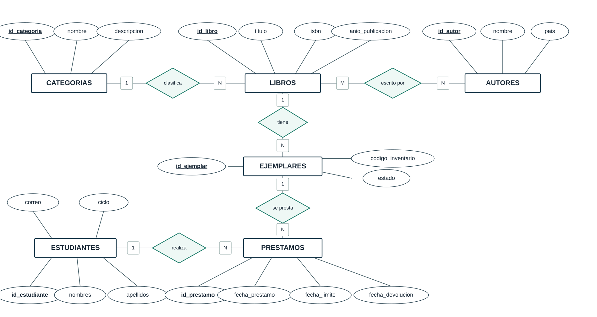

# Modelo Entidad–Relación (notación Chen)

El modelo conceptual incluye seis entidades. Los rombos representan relaciones y las etiquetas 1, M y N indican cardinalidades. La relación M:N entre libros y autores se implementa físicamente mediante la tabla intermedia `LIBRO_AUTOR`.

[Ver diagrama vectorial SVG](entidad_relacion.svg) · [Ver modelo relacional](modelo_relacional.md)
