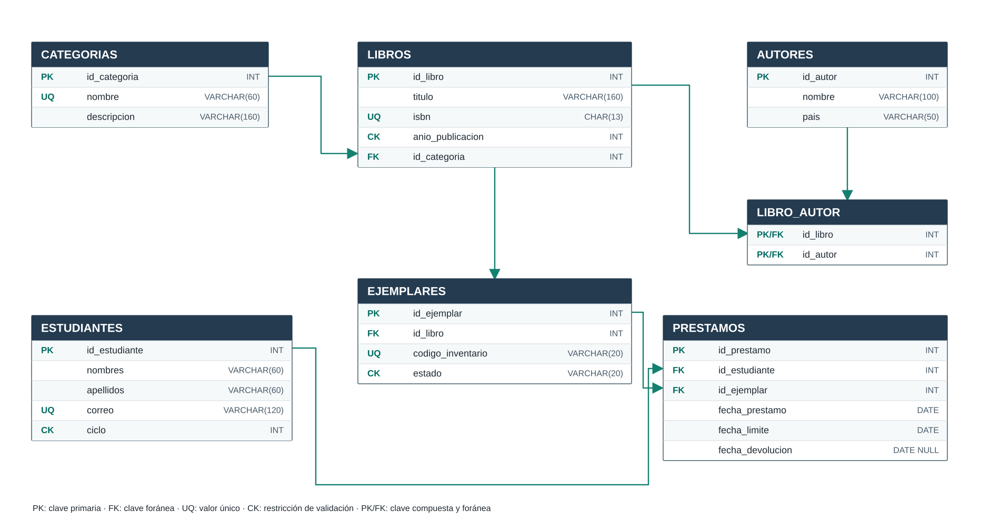

# Modelo relacional — siete tablas

Las tablas se relacionan mediante claves foráneas. La clave primaria de `LIBRO_AUTOR` es compuesta: `(id_libro, id_autor)`. Las flechas apuntan desde las tablas de origen hacia los campos de clave foránea de la tabla dependiente.

[Ver diagrama vectorial SVG](modelo_relacional.svg) · [Ver Entidad–Relación](entidad_relacion.md)
