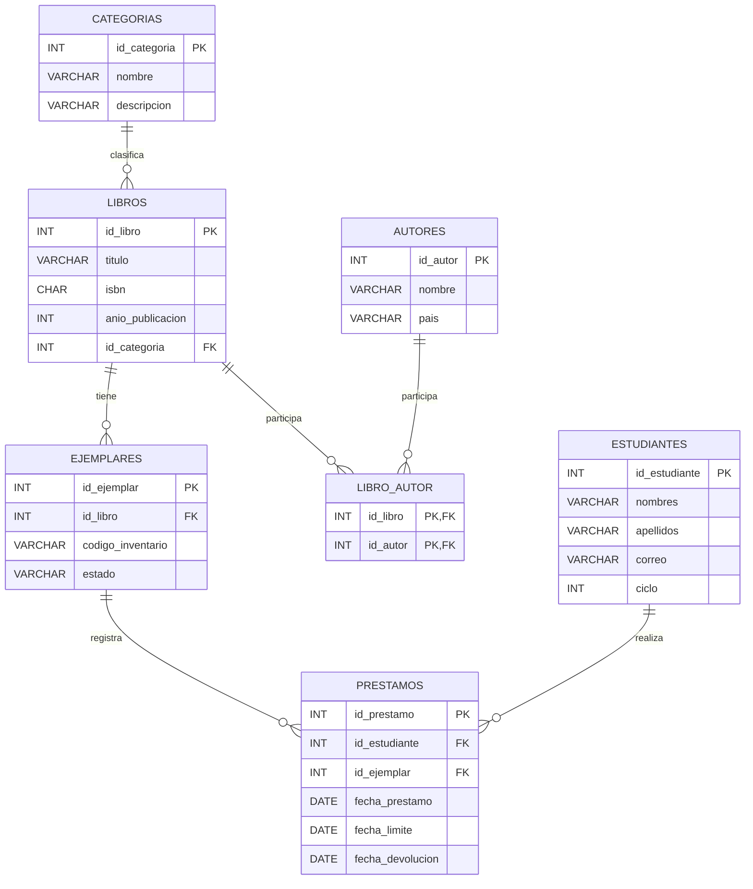

# Informe de fin de unidad — Biblioteca Universitaria

**Universidad Nacional de Loja — Carrera de Computación**  
**Base de Datos · Unidad 1 · Ciclo 3A**  
**Estudiante:** Emerson Chamba Galarza  
**Docente:** Edwin René Guamán Quinche
**Fecha:** 9 de noviembre de 2026  
**Enlace Git:** https://github.com/ezequiell07/AA_BASEDEDATOS_2026

## 1. Título
Diseño e implementación de una base de datos relacional para la gestión de libros, autores, ejemplares físicos y préstamos en una biblioteca universitaria.

## 2. Contexto del problema
En una biblioteca universitaria se registran los libros disponibles y los préstamos que realizan los estudiantes. Cuando esta información se guarda en registros separados, se dificulta identificar las copias físicas de un mismo título y controlar las fechas de devolución. El problema afecta a los estudiantes, al personal y al control del inventario de la institución. Se propone reunir la información en una base de datos relacional.

## 3. Objetivos
**General:** diseñar e implementar una base de datos relacional en MySQL para registrar libros y préstamos y consultar su estado.

**Específicos:** (1) elaborar los modelos E-R y relacional, identificando entidades, atributos, claves y cardinalidades; (2) crear siete tablas, insertar datos de prueba y desarrollar cinco consultas de álgebra relacional traducidas a SQL.

## 4. Modelos de la base de datos
Las seis entidades conceptuales son categorías, autores, estudiantes, libros, ejemplares y préstamos. La relación M:N de libros y autores se transforma en la tabla LIBRO_AUTOR. En total hay siete tablas.

[Modelo relacional](../diagramas/modelo_relacional.md).

## 5. Código SQL
Las tablas se crearon con `PRIMARY KEY`, `FOREIGN KEY`, `NOT NULL`, `UNIQUE`, `DEFAULT` y `CHECK`. Se importaron 91 registros de prueba, cuyos conteos son:

| Tabla | Registros |
|---|---:|
| CATEGORIAS | 7 |
| AUTORES | 9 |
| ESTUDIANTES | 9 |
| LIBROS | 12 |
| LIBRO_AUTOR | 17 |
| EJEMPLARES | 16 |
| PRESTAMOS | 21 |
| **Total** | **91** |

[DDL](../sql/01_creacion_tablas.sql) · [DML](../sql/02_inserciones.sql) · [Script completo](../sql/biblioteca_mysql_completo.sql).

## 6. Cinco consultas
La consulta de vencidos aplica selección y reunión; la de correos usa unión; la de libros nunca prestados usa diferencia; la de préstamos pendientes combina tablas; y la quinta agrupa por categoría.

| Consulta | Filas esperadas |
|---|---:|
| Vencidos sin devolver | 4 |
| Correos únicos | 6 |
| Títulos sin préstamos | 2 |
| Pendientes | 11 |
| Categorías con al menos dos préstamos | 6 |

[Álgebra relacional](Algebra_relacional.md) · [Código SQL](../sql/03_consultas.sql).

## 7. Conclusiones
Separar los títulos de sus ejemplares permitió controlar cada copia por separado. La tabla LIBRO_AUTOR resolvió la relación entre varios libros y autores. La implementación de las claves primarias y foráneas permitió ordenar los registros. Finalmente, las consultas facilitan detectar préstamos vencidos, pendientes y categorías con mayor movimiento.

## 8. Bibliografía IEEE
[1] P. P. Chen, “The entity-relationship model—toward a unified view of data,” ACM Transactions on Database Systems, vol. 1, no. 1, pp. 9–36, 1976, doi: 10.1145/320434.320440.

[2] Oracle, “MySQL 8.4 Reference Manual: CREATE TABLE Statement,” https://dev.mysql.com/doc/refman/8.4/en/create-table.html.

[3] Oracle, “MySQL 8.4 Reference Manual: FOREIGN KEY Constraints,” https://dev.mysql.com/doc/refman/8.4/en/create-table-foreign-keys.html.
